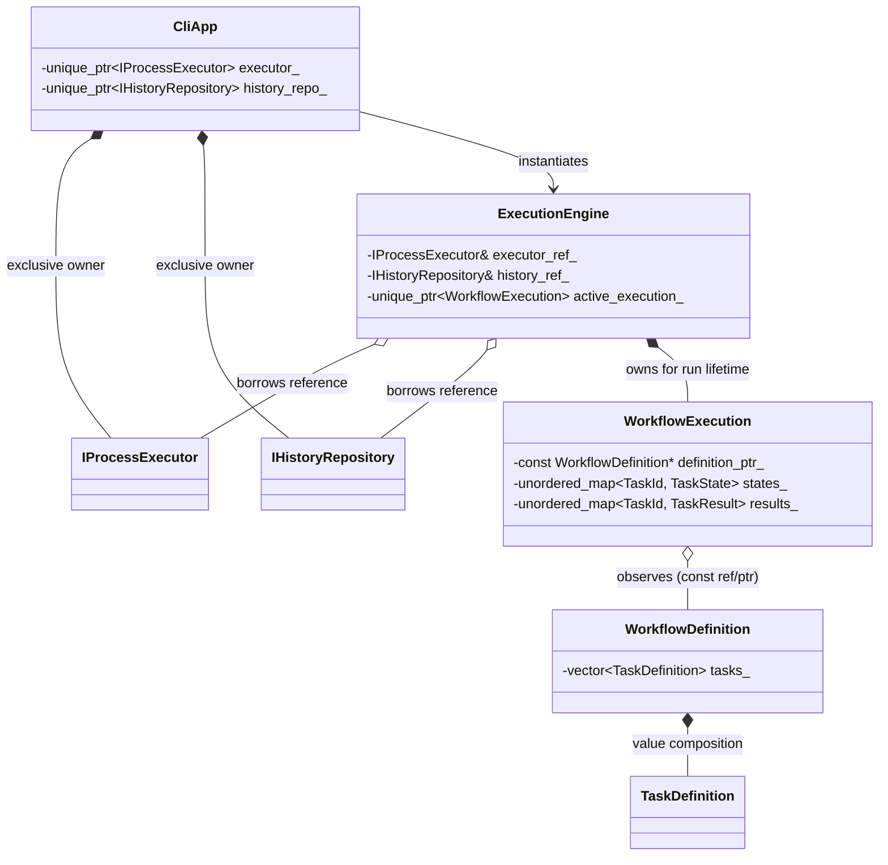
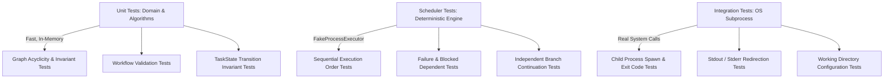

# TaskForge: Software Architecture & Design Decisions

## 1. Architectural Philosophy & Guiding Principles

TaskForge is engineered around four core tenets:
1. **Explicit Invariants & Strong Value Types**: Invariants are established at boundary crossings (e.g. manifest parsing) and maintained throughout object lifecycles. Domain models use value semantics wherever possible.
2. **Explicit Ownership & Deterministic Lifetimes (RAII)**: Every object has a single unambiguous owner. Heap allocation is minimized; polymorphism is used only across genuine behavioral and system boundaries (e.g. process execution, history persistence).
3. **Decoupled Orchestration**: The scheduling algorithm knows *nothing* about operating system processes, pipes, or Windows/POSIX APIs. It interacts solely with an abstract process executor interface (`IProcessExecutor`), enabling 100% deterministic, high-speed unit testing.
4. **Pragmatic SOLID Design**: Abstractions are introduced only where variation or testing requires them. Components that have no variation (e.g., the dependency graph data structure or validation rules) are concrete classes.

---

## 2. High-Level Architectural Layers

TaskForge follows a clean, layered architecture with strict dependency rules pointing inwards:

```mermaid
graph TD
    subgraph Presentation_Layer["Presentation Layer (CLI)"]
        CLI["CLI Command Parser<br/>(validate, run, history)"]
        Reporter["Console / Terminal Reporter<br/>(Formatted output, color, tables)"]
    end

    subgraph Infrastructure_Layer["Infrastructure Layer"]
        Parser["WorkflowParser<br/>(nlohmann/json)"]
        SysExec["SystemProcessExecutor<br/>(Windows CreateProcessW / POSIX)"]
        HistoryRepo["FileHistoryRepository<br/>(JSON Journal Persistence)"]
    end

    subgraph Orchestration_Layer["Orchestration Layer"]
        Engine["ExecutionEngine / WorkflowScheduler"]
        IExec["<<interface>><br/>IProcessExecutor"]
        IHistory["<<interface>><br/>IHistoryRepository"]
    end

    subgraph Domain_Layer["Domain Layer (Core - Zero Dependencies)"]
        Domain["TaskId<br/>TaskDefinition<br/>WorkflowDefinition<br/>TaskState<br/>TaskResult<br/>WorkflowExecution"]
        Graph["DependencyGraph<br/>(Acyclicity & Topological Sort)"]
        Validator["WorkflowValidator<br/>(Invariants & Diagnostic Rules)"]
    end

    CLI --> Engine
    CLI --> Parser
    CLI --> Validator
    CLI --> Reporter

    Engine --> IExec
    Engine --> IHistory
    Engine --> Domain
    Engine --> Graph

    SysExec ..|> IExec
    HistoryRepo ..|> IHistory
    Parser --> Domain
    Validator --> Domain
    Validator --> Graph
```

---

## 3. Major Architectural Boundaries & Component Analysis

Each major component is evaluated against the 9 architectural criteria specified in the design framework.

---

### Component 1: `TaskDefinition` & `WorkflowDefinition` (Domain Entities)

1. **Why it exists**: Provides an immutable, type-safe in-memory representation of workflow configuration.
2. **What it owns and what it does not own**:
   - Owns: Its strings, vectors of arguments, filesystem paths, and prerequisite IDs.
   - Does not own: Process handles, scheduler state, or runtime results.
3. **What information it receives and returns**: Constructed from parsed manifest data; provides `const` accessors for task attributes.
4. **How it interacts with other components**: Passed by `const&` to the `WorkflowValidator`, `DependencyGraph`, and `ExecutionEngine`.
5. **Which objects it owns vs references**: Holds owned value members (`TaskId`, `std::vector<std::string>`). No raw pointers or references.
6. **Whether it needs an interface**: **No**. It represents pure data (an immutable value object / aggregate root). There are no alternative implementations or runtime polymorphisms.
7. **Which SOLID principles apply**:
   - **SRP (Single Responsibility Principle)**: Represents and encapsulates workflow configuration data and its immediate invariants.
8. **Simpler alternative**: A raw `std::map<string, string>`. *Why rejected*: Loss of type safety, missing invariants, frequent string allocations, and prone to runtime typos.
9. **Testing difficulty addressed**: Enables pure, deterministic unit testing of data structures with zero mocks or setup.

---

### Component 2: `WorkflowParser` (Infrastructure Boundary)

1. **Why it exists**: Translates external serialization formats (JSON files) into internal domain types (`WorkflowDefinition`), shielding domain models from third-party JSON parser libraries.
2. **What it owns and what it does not own**:
   - Owns: Temporary JSON parsing buffers and file stream handles during parse execution.
   - Does not own: The resulting `WorkflowDefinition` (ownership is transferred to caller via move semantics).
3. **What information it receives and returns**:
   - Receives: `std::filesystem::path` or `std::string_view` (JSON payload).
   - Returns: `std::expected<WorkflowDefinition, ParseError>` (or a result object containing line numbers and diagnostics).
4. **How it interacts with other components**: Calls JSON deserializers and populates domain structs.
5. **Which objects it owns vs references**: Temporary local parser state; returns newly created domain objects by value (move).
6. **Whether it needs an interface**: **No interface initially**. A single concrete class is sufficient for JSON. If YAML or TOML support is required in the future, an `IWorkflowParser` can be extracted trivially.
7. **Which SOLID principles apply**:
   - **SRP**: Translating external serialization format to domain objects.
   - **DIP**: The domain layer does NOT depend on `nlohmann/json`; the parser depends on both.
8. **Simpler alternative**: Letting `TaskDefinition` deserialize itself directly using JSON macros. *Why rejected*: Pollutes domain headers with third-party JSON dependencies, increases compile times, and violates separation of concerns.
9. **Testing difficulty addressed**: Allows unit tests to verify parsing of malformed syntax, missing fields, and type errors with dedicated fixture strings.

---

### Component 3: `DependencyGraph` & `WorkflowValidator` (Domain Validation)

1. **Why it exists**: Encapsulates graph data structures, cycle detection algorithms (Tarjan's / DFS White-Gray-Black coloring), and workflow semantic validation before any execution begins.
2. **What it owns and what it does not own**:
   - `DependencyGraph` owns an adjacency list `std::unordered_map<TaskId, std::vector<TaskId>>` and in-degree tables.
   - Does not own the `TaskDefinition` objects (references them or indexes them by `TaskId`).
3. **What information it receives and returns**:
   - Receives: `WorkflowDefinition const&`.
   - Returns: `ValidationResult` (containing boolean `is_valid` and a collection of actionable `ValidationError` objects).
4. **How it interacts with other components**: Invoked by the CLI `validate` command and as the mandatory first step before `ExecutionEngine::run()`.
5. **Which objects it owns vs references**: Owns graph adjacency tables; references `TaskId` values.
6. **Whether it needs an interface**: **No**. Graph validation and cycle detection are mathematical domain algorithms with deterministic behavior.
7. **Which SOLID principles apply**:
   - **SRP**: Purely responsible for dependency structure, acyclicity, and semantic integrity.
8. **Simpler alternative**: Validating dependencies on the fly during execution. *Why rejected*: Can lead to partial execution where early tasks run and succeed only to crash midway because of a downstream cycle or missing task.
9. **Testing difficulty addressed**: Cycle detection and validation edge cases can be tested exhaustively with compact unit tests in milliseconds without touching disk or OS processes.

---

### Component 4: `IProcessExecutor` (Infrastructure Abstraction Interface)

1. **Why it exists**: Decouples the execution and scheduling logic from host operating-system process APIs (`CreateProcessW` on Windows, `fork`/`exec` or `posix_spawnp` on POSIX).
2. **What it owns and what it does not own**:
   - Owns: OS process handles, job objects, and pipe handles during active execution.
   - Does not own: The tasks or workflow definitions.
3. **What information it receives and returns**:
   - Receives: `ExecutionRequest` (executable path, argument list, working directory, timeout).
   - Returns: `ExecutionResponse` (exit code, stdout, stderr, execution duration, status).
4. **How it interacts with other components**: Called by `ExecutionEngine` to run ready tasks.
5. **Which objects it owns vs references**: Passed requests by value/const reference; returns execution results by value.
6. **Whether it needs an interface**: **YES**. This is the most crucial interface in the architecture.
   - In production: `SystemProcessExecutor` launches real OS processes.
   - In automated tests: `FakeProcessExecutor` simulates process execution, immediate exits, custom exit codes, stdout/stderr emissions, simulated delays, or launch failures without spawning real OS processes.
7. **Which SOLID principles apply**:
   - **DIP (Dependency Inversion Principle)**: High-level scheduling policy does not depend on low-level OS process APIs; both depend on `IProcessExecutor`.
   - **OCP (Open-Closed Principle)**: New execution strategies (e.g., containerized execution via Docker or sandboxed execution) can be added without modifying the scheduler.
8. **Simpler alternative**: Directly calling `std::system()`. *Why rejected*:
   - `std::system()` invokes the system shell (`cmd.exe` or `/bin/sh`), introducing quoting bugs, security injection risks, and poor exit code fidelity.
   - Capturing stdout and stderr separately via `std::system()` is impossible without temporary files.
   - Cannot be substituted or mocked in unit tests, making automated test suites slow, non-deterministic, and hazardous.
9. **Testing difficulty addressed**: Eliminates test flakiness, allows tests to simulate process crashes, exit code failures, and large output streams instantaneously.

---

### Component 5: `ExecutionEngine` / `WorkflowScheduler` (Orchestration Layer)

1. **Why it exists**: Coordinates workflow execution. Evaluates the dependency graph, determines which tasks are `Ready`, transitions states, dispatches tasks to `IProcessExecutor`, updates `WorkflowExecution`, and propagates `Blocked` status on failures.
2. **What it owns and what it does not own**:
   - Owns: The active `WorkflowExecution` runtime state.
   - Does not own: The `IProcessExecutor` (holds reference/pointer injected via constructor).
   - Does not own: The `WorkflowDefinition` (holds `const&`).
3. **What information it receives and returns**:
   - Receives: `WorkflowDefinition const&` and `IProcessExecutor&`.
   - Returns: `WorkflowExecution` (final state of all tasks and execution summary).
4. **How it interacts with other components**: Queries `DependencyGraph` for readiness; calls `IProcessExecutor::execute()`; notifies `ConsoleReporter` of progress events.
5. **Which objects it owns vs references**: Injected dependencies via references or non-owning pointers; owns runtime state.
6. **Whether it needs an interface**: **No interface for sequential execution initially**. The scheduler is the orchestration core. If parallel or distributed schedulers are introduced in Milestone 6, an `IScheduler` interface can be extracted.
7. **Which SOLID principles apply**:
   - **SRP**: Scheduling task progression and state transition orchestration.
   - **DIP**: Injects `IProcessExecutor` rather than instantiating concrete OS launchers.
8. **Simpler alternative**: Iterating over tasks in an arbitrary topological order with a simple `for` loop. *Why rejected*: Does not support dynamic failure branches, cannot block dependents while allowing independent tasks to complete, and cannot cleanly evolve into a parallel executor.
9. **Testing difficulty addressed**: Enables full verification of sequential execution, failure propagation, and independent branch continuation using `FakeProcessExecutor`.

---

### Component 6: `IHistoryRepository` & `FileHistoryRepository` (Persistence Boundary)

1. **Why it exists**: Persists execution summaries, timestamps, and task outcomes to disk for post-run inspection via `taskforge history`.
2. **What it owns and what it does not own**:
   - Owns: File stream handles and file paths in the local cache/journal directory.
   - Does not own: The domain objects.
3. **What information it receives and returns**:
   - Receives: `WorkflowExecution const&` to persist.
   - Returns: `std::vector<ExecutionSummary>` for history queries.
4. **How it interacts with other components**: Called by CLI runner upon workflow completion; called by CLI history command.
5. **Which objects it owns vs references**: Holds repository file paths; receives domain summaries by `const&`.
6. **Whether it needs an interface**: **YES**. Allows unit tests to test execution without disk I/O using an `InMemoryHistoryRepository`.
7. **Which SOLID principles apply**:
   - **DIP**: Core engine and CLI rely on `IHistoryRepository` abstraction; `FileHistoryRepository` implements it.
8. **Simpler alternative**: Directly appending lines to a text file in `main()`. *Why rejected*: Untestable, fragile, unformatted, and mixes CLI concerns with storage logic.
9. **Testing difficulty addressed**: Prevents file system pollution during automated tests.

---

### Component 7: `CliApp` & `ConsoleReporter` (Presentation Layer)

1. **Why it exists**: Parses command-line flags/arguments and renders readable, ANSI-colorized terminal summaries, progress indicators, and actionable error messages.
2. **What it owns and what it does not own**:
   - Owns: Output stream references (`std::ostream&`, defaulting to `std::cout` and `std::cerr`).
   - Does not own: Workflow or execution data.
3. **What information it receives and returns**:
   - Receives: Command line arguments `(int argc, char** argv)`.
   - Returns: Process exit code (`0` for success, non-zero for failure).
4. **How it interacts with other components**: Parses CLI args, invokes `WorkflowParser`, `WorkflowValidator`, `ExecutionEngine`, and passes results to `ConsoleReporter`.
5. **Which objects it owns vs references**: Holds non-owning stream references for easy redirection in tests.
6. **Whether it needs an interface**: **No**. Concrete class parameterizing the output stream (`std::ostream&`) is sufficient for testing.
7. **Which SOLID principles apply**:
   - **SRP**: CLI presentation only. Contains zero business logic, zero scheduling logic, and zero process spawning logic.
8. **Simpler alternative**: Putting all CLI parsing and console printing directly in `main()`. *Why rejected*: Unmaintainable, untestable `main()` function.
9. **Testing difficulty addressed**: Passing `std::ostringstream` allows automated tests to assert on exact CLI output formatting without intercepting global `std::cout`.

---

## 4. Object Ownership and Lifetime Analysis



### Ownership Decision Matrix

| Relationship | Mechanism | Justification |
| :--- | :--- | :--- |
| `CliApp` $\rightarrow$ `IProcessExecutor` | `std::unique_ptr<IProcessExecutor>` | `CliApp` owns the concrete implementation instance exclusively. |
| `ExecutionEngine` $\rightarrow$ `IProcessExecutor` | `IProcessExecutor&` (Lvalue Reference) | Engine only borrows the executor for the duration of execution. No ownership transfer. |
| `WorkflowDefinition` $\rightarrow$ `TaskDefinition` | `std::vector<TaskDefinition>` (Value) | Direct composition. Tasks have value semantics and their lifetime is bound to the workflow. |
| `WorkflowExecution` $\rightarrow$ `TaskResult` | `std::unordered_map<TaskId, TaskResult>` (Value) | Results are owned values stored inside the execution aggregate. |
| `WorkflowExecution` $\rightarrow$ `WorkflowDefinition` | `WorkflowDefinition const&` (Reference) | Execution observes the immutable definition; it does not duplicate or take ownership of it. |

> [!IMPORTANT]
> **No Premature `std::shared_ptr`**:
> We explicitly avoid `std::shared_ptr` across the core engine. Shared ownership obscures object lifetimes, introduces atomic reference-counting overhead, and often masks poor architectural boundaries. Unique ownership (`std::unique_ptr`) and strict borrowing (`const&`) keep lifetimes completely clear and deterministic.

---

## 5. Process Execution & Platform Strategy

Direct process launching is mandatory to avoid shell injection, argument parsing discrepancies, and shell quoting hazards.

### Platform Implementations of `IProcessExecutor`
1. **Windows Native (`WindowsProcessExecutor`)**:
   - Uses `CreateProcessW` directly.
   - Sets up anonymous pipes with `SECURITY_ATTRIBUTES` for redirecting `stdout` and `stderr`.
   - Uses `WaitForSingleObject` or `WaitForMultipleObjects` to detect completion.
   - Closes process and thread handles using RAII wrappers (`HandleHolder` struct).
   - Queries exit code using `GetExitCodeProcess`.
2. **POSIX (`PosixProcessExecutor`)**:
   - Uses `posix_spawnp` (or `pipe()`, `fork()`, `execvp()`).
   - Uses non-blocking pipes or select/poll to capture `stdout` and `stderr` without deadlocking.
   - Collects termination status using `waitpid()`.
3. **Test Environment (`FakeProcessExecutor`)**:
   - Pure in-memory mock.
   - Configurable behavior per `TaskId` or executable name (return exit code 0, return exit code 1, throw exception, output custom text, delay for $N$ ms).
   - Records all launched invocations for verification.

---

## 6. Architectural Alternatives & Trade-Off Matrix

| Design Area | Chosen Approach | Alternative Considered | Trade-Off & Reason for Choice |
| :--- | :--- | :--- | :--- |
| **Task Modeling** | Value Object (`TaskDefinition`) | Subclass hierarchy (`BaseTask`, `BuildTask`) | Value object treats task commands as data. Subclasses introduce unnecessary virtual tables, memory allocations, and tight coupling without behavioral variance. |
| **Process Execution** | Direct OS API via `IProcessExecutor` | Shell execution via `std::system()` | `std::system()` is prone to shell injection, cannot separate stdout/stderr, and cannot be mocked in unit tests. Direct API is safe and testable. |
| **Scheduler Algorithm** | Dynamic Ready Queue & In-Degree | Static Topological Sort list | A static pre-sorted list cannot dynamically prune dependent tasks when a prerequisite fails, nor can it support parallel execution in later milestones. |
| **Manifest Parsing** | Decoupled `WorkflowParser` (`nlohmann/json`) | Custom parser or manual string splitting | Custom parsers are brittle and difficult to maintain. Decoupled parser keeps domain pure while leveraging a battle-tested JSON parser. |
| **Test Framework** | Catch2 (v3 via FetchContent) | Custom test runner / raw asserts | Catch2 provides expressive BDD assertions, section-based fixtures, excellent compiler diagnostics, and integrates cleanly with CTest. |
| **Error Handling** | Result types (`std::expected` / custom `Result<T, E>`) for expected domain errors; C++ exceptions for unexpected invariant violations | Exceptions for all errors | Validation failures (missing dependency, cycle) are normal business outcomes, not system exceptions. Result types make errors explicit in function signatures. |

---

## 7. Testing Strategy

Testing is integrated across all levels:



1. **Unit Tests (Pure Domain)**:
   - Zero I/O, zero network, zero OS process launches. Runs in milliseconds.
   - Validates cycle detection (direct cycles, indirect 5-node cycles, self-loops).
   - Validates state machine rules (illegal transitions must fail).
2. **Scheduler Simulation Tests**:
   - Uses `FakeProcessExecutor`.
   - Simulates multi-task diamond graphs:
     - $A \rightarrow B, C$; $B, C \rightarrow D$.
     - If $B$ fails, $D$ is blocked, but $C$ completes.
3. **Integration Tests (Subprocess Verification)**:
   - Spawns known host executables (e.g. `cmake --version`, `git --version`, or simple platform commands like `whoami` or test binaries).
   - Asserts on captured stdout/stderr, exit code accuracy, and working directory correctness.
