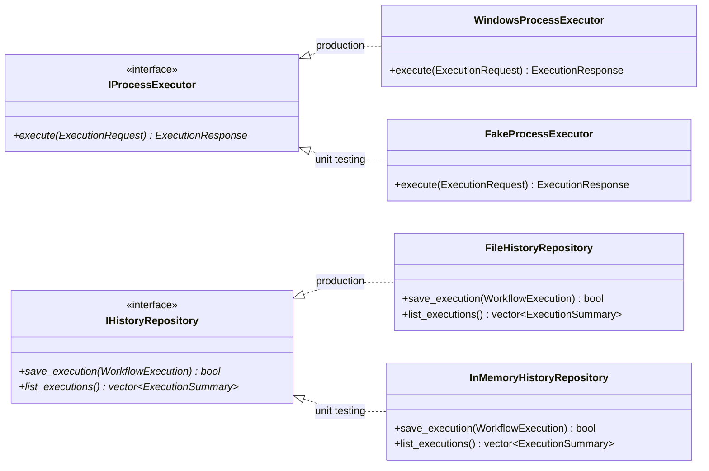
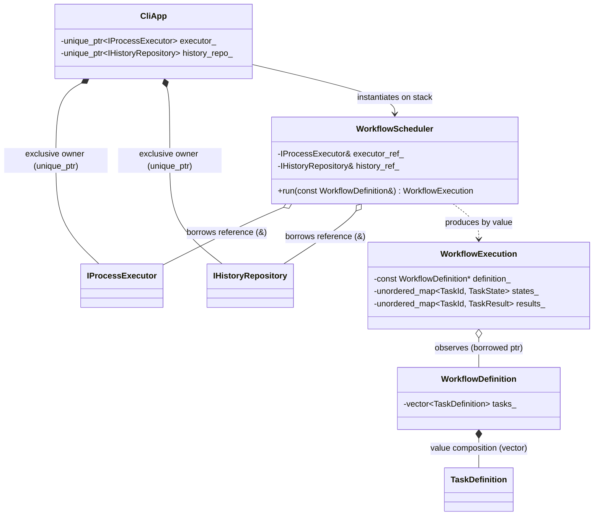
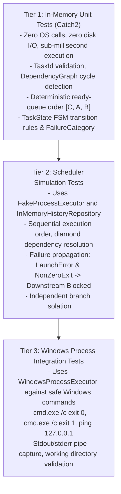

# TaskForge: Software Architecture & Design Decisions

## 1. Architectural Philosophy & Guiding Principles

TaskForge is engineered around four core tenets:
1. **Explicit Invariants & Strong Value Types**: Invariants are established at boundary crossings (e.g., manifest parsing) and maintained throughout object lifecycles. Domain models use value semantics wherever possible.
2. **Explicit Ownership & Deterministic Lifetimes (RAII)**: Every object has a single unambiguous owner. Heap allocation is minimized; polymorphism is used only across genuine behavioral and system boundaries (e.g., OS process execution, history persistence).
3. **Decoupled Orchestration**: The scheduling algorithm knows *nothing* about operating system processes, pipes, or Windows APIs. It interacts solely with an abstract process executor interface (`IProcessExecutor`), enabling 100% deterministic, high-speed unit testing.
4. **Pragmatic SOLID Design (Zero Premature Abstraction)**: Abstractions are introduced only where variation or testing requires them. Components that have no variation (e.g., graph algorithms, validation rules, CLI formatters) are concrete classes.

---

## 2. Fundamental Architectural Distinctions

The architecture enforces seven essential distinctions:

| Distinction | Left Side | Right Side | Architectural Implication |
| :--- | :--- | :--- | :--- |
| **1. Specification vs. Runtime** | `WorkflowDefinition` (Immutable blueprint) | `WorkflowExecution` (Mutable session state) | Definitions can be safely reused or validated offline; executions track dynamic timestamps, exit codes, and task progress. |
| **2. Identity vs. Ownership** | `TaskId` (Value token) | `TaskDefinition` (Data container) | Identifiers can be freely copied, hashed, and passed across components without managing object lifetimes or pointer aliasing. |
| **3. Dependencies vs. Ownership** | Dependency Graph (`TaskId` $\rightarrow$ `TaskId`) | Ownership Tree (`Workflow` owns `vector<Task>`) | Tasks do not hold pointers or references to other tasks. Graph algorithms operate on ID adjacency tables. |
| **4. Scheduling Policy vs. Mechanism** | `WorkflowScheduler` (Readiness & failure logic) | `IProcessExecutor` (OS process execution) | Scheduler logic is tested instantaneously in memory with zero OS calls using `FakeProcessExecutor`. |
| **5. Runtime State vs. Persisted History** | `TaskState` (In-memory FSM) | `FileHistoryRepository` (Durable JSON journal) | Core engine remains independent of disk persistence, directories, and serialization schemas. |
| **6. Active Failure vs. Dependency Block** | `Failed` (Launch error or non-zero exit code) | `Blocked` (Prerequisite failed; never executed) | Eliminates user confusion; independent branches continue executing while downstream dependents of failed tasks abort safely. |
| **7. Historical Audit vs. Safe Command Repeat** | Saved Execution Record (Inspection) | Re-executing External Command (Side effects) | Historical logs provide post-mortem auditing; re-running external commands is never assumed to be idempotent. |

---

## 3. High-Level Architectural Layers

TaskForge follows a clean, layered architecture with strict dependency rules pointing inwards:

```mermaid
graph TD
    subgraph Presentation_Layer["Presentation Layer (CLI)"]
        CLI["CLI Command Parser<br/>(validate, run, history)"]
        Reporter["Console / Terminal Reporter<br/>(Formatted output, color, tables)"]
    end

    subgraph Infrastructure_Layer["Infrastructure Layer"]
        Parser["WorkflowParser<br/>(nlohmann/json)"]
        SysExec["WindowsProcessExecutor<br/>(Win32 CreateProcessW / Pipes)"]
        HistoryRepo["FileHistoryRepository<br/>(JSON Journal Persistence)"]
    end

    subgraph Orchestration_Layer["Orchestration Layer"]
        Engine["WorkflowScheduler"]
        IExec["<<interface>><br/>IProcessExecutor"]
        IHistory["<<interface>><br/>IHistoryRepository"]
    end

    subgraph Domain_Layer["Domain Layer (Core - Zero Dependencies)"]
        Domain["TaskId<br/>TaskDefinition<br/>WorkflowDefinition<br/>TaskState<br/>TaskResult<br/>WorkflowExecution"]
        Graph["DependencyGraph<br/>(Acyclicity & Topological Readiness)"]
        Validator["WorkflowValidator<br/>(Invariants & Diagnostic Rules)"]
    end

    CLI --> Engine
    CLI --> Parser
    CLI --> Validator
    CLI --> Reporter

    Engine --> IExec
    Engine --> IHistory
    Engine --> Domain
    Engine --> Graph

    SysExec ..|> IExec
    HistoryRepo ..|> IHistory
    Parser --> Domain
    Validator --> Domain
    Validator --> Graph
```

---

## 4. Evaluation of Proposed Boundaries & Interfaces

Every major component is evaluated against architectural criteria to eliminate unnecessary abstractions and premature inheritance.



### Component Analysis Summary

| Component | Responsibility | Concrete vs Interface | Why an Interface is (or is NOT) Justified |
| :--- | :--- | :--- | :--- |
| **`TaskId`** | Value identity token | Concrete Value Type | No behavioral variation. Plain value type. |
| **`TaskDefinition`** | Task configuration container | Concrete Value Type | No subclasses. All tasks differ only in data (binary/arguments), not in runtime execution behavior. |
| **`WorkflowDefinition`** | Aggregate of task definitions | Concrete Class | Single responsibility, design-time aggregate. No interface needed. |
| **`DependencyGraph`** | Adjacency tables & cycle detection | Concrete Class | Deterministic mathematical graph algorithm. No interface needed. |
| **`WorkflowValidator`** | Semantic validation rules | Concrete Class | Deterministic domain logic. No interface needed. |
| **`WorkflowScheduler`** | Task readiness and lifecycle coordination | Concrete Class | Orchestration core. Sequential scheduling is direct; parallel scheduler can be introduced in Milestone 6 without premature interface pollution. |
| **`IProcessExecutor`** | Child process execution boundary | **Abstract Interface** | **JUSTIFIED**: Isolates Win32 OS calls (`CreateProcessW`) from scheduling policy; enables `FakeProcessExecutor` for instant, deterministic unit testing without spawning real OS processes. |
| **`IHistoryRepository`** | Execution history persistence | **Abstract Interface** | **JUSTIFIED**: Isolates file I/O from execution; enables `InMemoryHistoryRepository` for tests without polluting local disk. |
| **`WorkflowParser`** | JSON deserialization via `nlohmann/json` | Concrete Class | JSON is the project manifest format. Avoids premature `IParser` until multiple formats are genuinely required. |
| **`ConsoleReporter`** | Terminal formatting & progress output | Concrete Class | Parameterized by `std::ostream&` (defaults to `std::cout`). Fully testable using `std::ostringstream` without an interface. |

---

## 5. Object Ownership and Lifetime Analysis



### 5.1 Ownership Decision: `WorkflowExecution` by Value vs. `std::unique_ptr`

We explicitly evaluated whether `WorkflowScheduler` should own `WorkflowExecution` via `std::unique_ptr<WorkflowExecution>` or manage it **directly by value**:

| Criteria | `std::unique_ptr<WorkflowExecution>` | `WorkflowExecution` by Value | Evaluation |
| :--- | :--- | :--- | :--- |
| **Memory Allocation** | Requires separate heap allocation (`new`) | Zero separate heap allocation; lives in local frame / stack | **By Value wins**: Avoids unnecessary dynamic allocation. |
| **Polymorphism** | Pointer allows polymorphic dispatch | Concrete type only | **By Value wins**: `WorkflowExecution` is not polymorphic; no interface exists or is needed. |
| **Indirection & Cache** | Incurs pointer indirection (`->`) | Direct cache-friendly value access (`.`) | **By Value wins**: Simpler debugging and higher locality. |
| **Lifecycle & Transfer** | Move ownership via pointer | Move ownership via C++20 move semantics (`std::move`) | **By Value wins**: Natural return type: `WorkflowExecution WorkflowScheduler::run(const WorkflowDefinition&)`. |

**Decision**: `WorkflowExecution` is managed and returned **directly by value**. The scheduler constructs it as a local variable during `run()`, populates it throughout the execution loop, and returns it by value using move semantics to `CliApp`.

### 5.2 Lifetime Guarantee for Borrowed `WorkflowDefinition const&`

The scheduler and the active execution observe `WorkflowDefinition const&`. We guarantee zero dangling references through strict stack scoping:

1. **Owner**: `CliApp` parses the manifest and stores `WorkflowDefinition definition` as a local stack variable in `CliApp::run_command(...)`.
2. **Call Scope**: `CliApp` invokes `scheduler.run(definition)`.
3. **Guarantee**: Because `definition` is owned by the enclosing caller frame on the stack, its lifetime strictly supersedes the entire duration of `scheduler.run()`.
4. **Execution Snapshot**: Once `run()` completes and returns `WorkflowExecution`, if the execution must be inspected later or persisted to disk, `WorkflowExecution` stores all necessary summary data (task IDs, exit codes, output) by value. It does not attempt to extend the lifetime of `WorkflowDefinition`.

---

## 6. Deterministic Scheduling & Tie-Breaking Order

To guarantee repeatable, deterministic execution across all platforms and runs:

1. **The Hash Table Trap**: Iterating over `std::unordered_map` has an undefined, implementation-dependent order that varies with hashing seeds, standard library versions, and bucket allocations. It must **never** be used to select the next ready task.
2. **Two-Tier Deterministic Ordering Policy**:
   - **Primary Key**: **Declaration Index** in the workflow manifest. Tasks preserve their original sequence as parsed into `std::vector<TaskDefinition>`.
   - **Secondary Key**: **Lexicographical `TaskId`**. If declaration indices are identical or unavailable, tasks are ordered alphabetically by `id.value()`.
3. **Ready Queue Data Structure**:
   ```cpp
   struct DeterministicTaskOrder {
       const WorkflowDefinition* workflow;
       bool operator()(const TaskId& lhs, const TaskId& rhs) const {
           size_t idx_lhs = workflow->declaration_index_of(lhs);
           size_t idx_rhs = workflow->declaration_index_of(rhs);
           if (idx_lhs != idx_rhs) return idx_lhs < idx_rhs;
           return lhs.value() < rhs.value();
       }
   };
   // Ready queue maintains strict deterministic priority
   std::set<TaskId, DeterministicTaskOrder> ready_queue;
   ```
4. **Verification**: Automated unit tests assert that independent tasks with zero prerequisites declared in order $[C, A, B]$ execute in the exact order $C \rightarrow A \rightarrow B$.

---

## 7. Invariant Protection & Value Semantics

### The `const` Member Anti-Pattern
Declaring member variables `const` inside a class (e.g. `const TaskId id_;`) is an anti-pattern in Modern C++:
- It deletes default move-assignment (`operator=(Type&&)`) and copy-assignment.
- It disables `std::swap` and breaks `std::vector` reallocation, forcing expensive deep copies instead of zero-cost moves.

### The Correct Value-Semantic Architecture
1. **Private Non-Const Members**:
   ```cpp
   class TaskDefinition {
   private:
       friend class WorkflowDefinition;
       void set_declaration_index(size_t index) noexcept { declaration_index_ = index; }

       TaskId id_;
       std::string description_;
       std::filesystem::path executable_;
       std::vector<std::string> arguments_;
       std::optional<std::filesystem::path> working_directory_;
       std::vector<TaskId> dependencies_;
       size_t declaration_index_{0};
   };
   ```
2. **Construction-Time Invariant Enforcement**:
   - Private constructor accessible only via static factory functions (`TaskDefinition::create(...)`).
   - Rejects empty IDs, empty executables, invalid characters, and self-dependencies before the object is created.
3. **Const-Only Observers & Encapsulated Coordination**:
   - Read-only public accessors (`const TaskId& id() const noexcept`).
   - No public setters or mutators. Declaration index coordination is restricted strictly to `friend class WorkflowDefinition`.
   - Once constructed, `TaskDefinition` and `WorkflowDefinition` protect their domain properties from external mutation while remaining fully copyable, movable, and assignable.
   - Vector reallocation across $n$ elements requires $\mathcal{O}(n)$ element moves, where each element move performs an efficient $O(1)$ pointer transfer without heap reallocation. Moved-from objects enter a valid but unspecified state.

---

## 8. Failure Semantics & Categorization

To ensure actionable post-mortem diagnostics, `TaskResult` distinguishes between process-launch failures and execution failures:

```cpp
enum class FailureCategory {
    None,         // Succeeded, Blocked, or Skipped
    LaunchError,  // OS failed to create process (binary missing, permissions, bad path)
    NonZeroExit,  // Process launched and exited with non-zero return code
    Timeout,      // Process exceeded configured wall-clock limit
    SystemFault   // Win32 pipe broken, IO error, handle exhaustion
};
```

### Invariant Rules:
- If `failure_category == LaunchError`: `exit_code` is `std::nullopt` (no process ever ran); `os_error_code` contains Win32 `GetLastError()`; `error_message` contains the system error string.
- If `failure_category == NonZeroExit`: `exit_code` contains the process return code (e.g., `1`); `os_error_code` is `std::nullopt`.
- In both failure cases, the task enters `TaskState::Failed`, immediately causing all dependent tasks to transition to `TaskState::Blocked`.

---

## 9. Target Environment & Windows-Native Toolchain

### 9.1 Toolchain Reconnaissance Findings
A deep forensic inspection of the host Windows environment was performed:
- `git.exe` (v2.48.1) is installed and available in PATH.
- `vswhere.exe` is absent from all standard locations (`%ProgramFiles(x86)%\Microsoft Visual Studio\Installer\` and user directories).
- Neither `cl.exe`, `cmake.exe`, nor `link.exe` are present in system PATH or on disk.
- Windows Kits contains only an empty catalog; the Windows SDK developer headers and libraries are absent.
- Visual Studio IDE and Visual Studio Build Tools are **genuinely not installed** on this machine (only VC++ runtime redistributables and VS Code exist).

### 9.2 Toolchain Configuration & Verified Compiler
- **Verified Environment**: CMake 4.4.4 + MinGW Makefiles + GCC 16.2.0 (MSYS2 UCRT64).
- **Toolchain Deviation Note**: While MSVC (`cl.exe`) remains an intended future Windows target, Milestone 1 was compiled, tested, and verified under native Windows UCRT64 GCC 16.2.0 with `-std=c++20`. MSVC compatibility is not claimed until an explicit build under `cl.exe` succeeds.

To optionally install MSVC Build Tools via `winget` in an elevated PowerShell:

```powershell
# 1. Install CMake
winget install Kitware.CMake

# 2. Install Visual Studio 2022 Build Tools with C++ Workload
winget install Microsoft.VisualStudio.2022.BuildTools --override "--passive --wait --add Microsoft.VisualStudio.Workload.VCTools --includeRecommended"
```

After installation, developer tools are accessed via:
- Launching **Developer PowerShell for VS 2022** from the Windows Start Menu, or
- Invoking `vcvars64.bat` in a standard command prompt.

---

## 10. Windows Process Execution & Pipe Management

The `WindowsProcessExecutor` implements `IProcessExecutor` directly using Win32 APIs:

1. **Direct Process Spawning**:
   - Calls `CreateProcessW` directly (bypassing `cmd.exe` and `powershell.exe`).
   - Constructs argument strings with proper Win32 escaping rules (`CommandLineToArgvW` compatibility).
   - Sets `bInheritHandles = TRUE` only for designated pipe handles.
2. **Standard Output and Error Capture**:
   - Creates two anonymous pipes via `CreatePipe`: one for stdout, one for stderr.
   - Ensures the write end is inheritable, while the read end is non-inheritable (`SetHandleInformation`).
   - Uses separate reader threads or non-blocking I/O to read from stdout and stderr pipes simultaneously, preventing pipe buffer saturation deadlocks.
3. **Handle Lifetime Management**:
   - Process and pipe handles are wrapped in move-only `ScopedHandle` RAII structs closing via `CloseHandle()`.
4. **Exit Code & Timing**:
   - Waits for process termination with `WaitForSingleObject(pi.hProcess, timeout_ms)`.
   - Queries exit code using `GetExitCodeProcess`.

---

## 11. Testing Strategy

Testing is structured into three distinct tiers:



- **Safety Guarantee**: Automated tests never run destructive commands on the host machine.
- **Isolation Guarantee**: Scheduler logic is tested against `FakeProcessExecutor`, guaranteeing that scheduling bugs can be diagnosed and fixed without spawning a single operating-system process.

---

## 12. Design Trade-Offs and Unresolved Risks

| Area | Decision Made | Trade-Off Accepted | Unresolved Risk / Mitigation |
| :--- | :--- | :--- | :--- |
| **Execution State Ownership** | Stored and returned by value | Requires value move semantics | Mitigated by clean C++20 move constructors and zero-copy return. |
| **Scheduling Order** | Manifest declaration index tie-breaking | Requires tracking original manifest order | Mitigated by storing `declaration_index` in `TaskDefinition`. |
| **Manifest Format** | JSON via `nlohmann/json` | JSON lacks multi-line raw string literals compared to YAML. | Mitigated by structuring command arguments as arrays of strings rather than single shell strings. |
| **Win32 Pipe Deadlocks** | Async / multi-threaded pipe reader | Requires careful reader thread coordination before `WaitForSingleObject`. | Write focused integration tests capturing >1MB of stdout/stderr to verify no buffer blocking occurs. |
