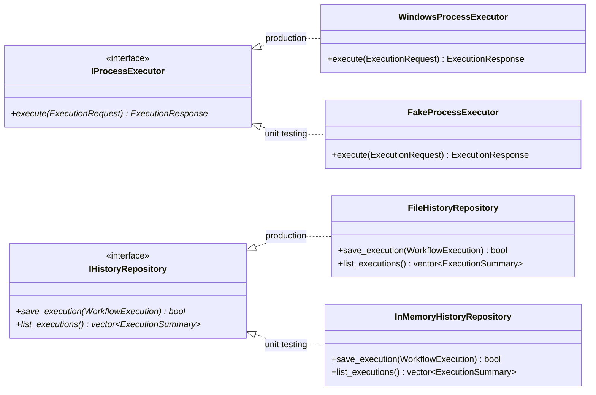
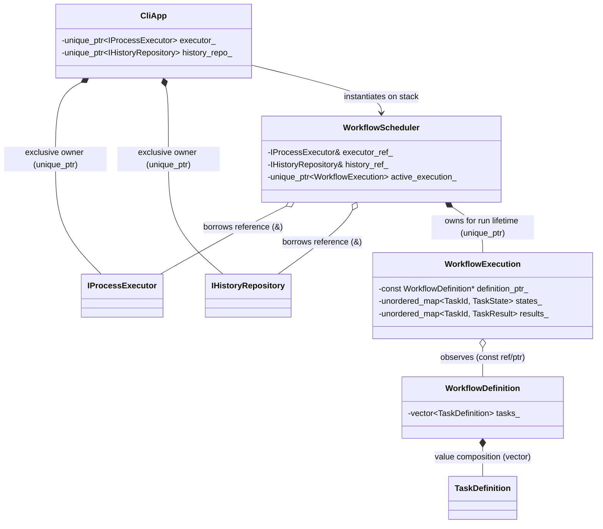
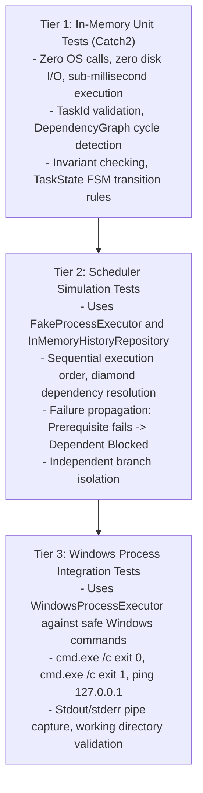

# TaskForge: Software Architecture & Design Decisions

## 1. Architectural Philosophy & Guiding Principles

TaskForge is engineered around four core tenets:
1. **Explicit Invariants & Strong Value Types**: Invariants are established at boundary crossings (e.g., manifest parsing) and maintained throughout object lifecycles. Domain models use value semantics wherever possible.
2. **Explicit Ownership & Deterministic Lifetimes (RAII)**: Every object has a single unambiguous owner. Heap allocation is minimized; polymorphism is used only across genuine behavioral and system boundaries (e.g., OS process execution, history persistence).
3. **Decoupled Orchestration**: The scheduling algorithm knows *nothing* about operating system processes, pipes, or Windows APIs. It interacts solely with an abstract process executor interface (`IProcessExecutor`), enabling 100% deterministic, high-speed unit testing.
4. **Pragmatic SOLID Design (Zero Premature Abstraction)**: Abstractions are introduced only where variation or testing requires them. Components that have no variation (e.g., graph algorithms, validation rules, CLI formatters) are concrete classes.

---

## 2. Fundamental Architectural Distinctions

The architecture enforces seven essential distinctions:

| Distinction | Left Side | Right Side | Architectural Implication |
| :--- | :--- | :--- | :--- |
| **1. Specification vs. Runtime** | `WorkflowDefinition` (Immutable blueprint) | `WorkflowExecution` (Mutable session state) | Definitions can be safely reused or validated offline; executions track dynamic timestamps, exit codes, and task progress. |
| **2. Identity vs. Ownership** | `TaskId` (Value token) | `TaskDefinition` (Data container) | Identifiers can be freely copied, hashed, and passed across components without managing object lifetimes or pointer aliasing. |
| **3. Dependencies vs. Ownership** | Dependency Graph (`TaskId` $\rightarrow$ `TaskId`) | Ownership Tree (`Workflow` owns `vector<Task>`) | Tasks do not hold pointers or references to other tasks. Graph algorithms operate on ID adjacency tables. |
| **4. Scheduling Policy vs. Mechanism** | `WorkflowScheduler` (Readiness & failure logic) | `IProcessExecutor` (OS process execution) | Scheduler logic is tested instantaneously in memory with zero OS calls using `FakeProcessExecutor`. |
| **5. Runtime State vs. Persisted History** | `TaskState` (In-memory FSM) | `FileHistoryRepository` (Durable JSON journal) | Core engine remains independent of disk persistence, directories, and serialization schemas. |
| **6. Active Failure vs. Dependency Block** | `Failed` (Process executed and failed) | `Blocked` (Prerequisite failed; never executed) | Eliminates user confusion; independent branches continue executing while downstream dependents of failed tasks abort safely. |
| **7. Historical Audit vs. Safe Command Repeat** | Saved Execution Record (Inspection) | Re-executing External Command (Side effects) | Historical logs provide post-mortem auditing; re-running external commands is never assumed to be idempotent. |

---

## 3. High-Level Architectural Layers

TaskForge follows a clean, layered architecture with strict dependency rules pointing inwards:

```mermaid
graph TD
    subgraph Presentation_Layer["Presentation Layer (CLI)"]
        CLI["CLI Command Parser<br/>(validate, run, history)"]
        Reporter["Console / Terminal Reporter<br/>(Formatted output, color, tables)"]
    end

    subgraph Infrastructure_Layer["Infrastructure Layer"]
        Parser["WorkflowParser<br/>(nlohmann/json)"]
        SysExec["WindowsProcessExecutor<br/>(Win32 CreateProcessW / Pipes)"]
        HistoryRepo["FileHistoryRepository<br/>(JSON Journal Persistence)"]
    end

    subgraph Orchestration_Layer["Orchestration Layer"]
        Engine["WorkflowScheduler / ExecutionEngine"]
        IExec["<<interface>><br/>IProcessExecutor"]
        IHistory["<<interface>><br/>IHistoryRepository"]
    end

    subgraph Domain_Layer["Domain Layer (Core - Zero Dependencies)"]
        Domain["TaskId<br/>TaskDefinition<br/>WorkflowDefinition<br/>TaskState<br/>TaskResult<br/>WorkflowExecution"]
        Graph["DependencyGraph<br/>(Acyclicity & Topological Readiness)"]
        Validator["WorkflowValidator<br/>(Invariants & Diagnostic Rules)"]
    end

    CLI --> Engine
    CLI --> Parser
    CLI --> Validator
    CLI --> Reporter

    Engine --> IExec
    Engine --> IHistory
    Engine --> Domain
    Engine --> Graph

    SysExec ..|> IExec
    HistoryRepo ..|> IHistory
    Parser --> Domain
    Validator --> Domain
    Validator --> Graph
```

---

## 4. Evaluation of Proposed Boundaries & Interfaces

Every major component is evaluated against architectural criteria to eliminate unnecessary abstractions and premature inheritance.



### Component Analysis Summary

| Component | Responsibility | Concrete vs Interface | Why an Interface is (or is NOT) Justified |
| :--- | :--- | :--- | :--- |
| **`TaskId`** | Value identity token | Concrete Value Type | No behavioral variation. Plain value type. |
| **`TaskDefinition`** | Task configuration container | Concrete Value Type | No subclasses. All tasks differ only in data (binary/arguments), not in runtime execution behavior. |
| **`WorkflowDefinition`** | Aggregate of task definitions | Concrete Class | Single responsibility, design-time aggregate. No interface needed. |
| **`DependencyGraph`** | Adjacency tables & cycle detection | Concrete Class | Deterministic mathematical graph algorithm. No interface needed. |
| **`WorkflowValidator`** | Semantic validation rules | Concrete Class | Deterministic domain logic. No interface needed. |
| **`WorkflowScheduler`** | Task readiness and lifecycle coordination | Concrete Class | Orchestration core. Sequential scheduling is direct; parallel scheduler can be introduced in Milestone 6 without premature interface pollution. |
| **`IProcessExecutor`** | Child process execution boundary | **Abstract Interface** | **JUSTIFIED**: Isolates Win32 OS calls (`CreateProcessW`) from scheduling policy; enables `FakeProcessExecutor` for instant, deterministic unit testing without spawning real OS processes. |
| **`IHistoryRepository`** | Execution history persistence | **Abstract Interface** | **JUSTIFIED**: Isolates file I/O from execution flow; enables `InMemoryHistoryRepository` for testing without disk pollution. |
| **`WorkflowParser`** | JSON deserialization via `nlohmann/json` | Concrete Class | JSON is the project manifest format. Avoids premature `IParser` until multiple formats are genuinely required. |
| **`ConsoleReporter`** | Terminal formatting & progress output | Concrete Class | Parameterized by `std::ostream&` (defaults to `std::cout`). Fully testable using `std::ostringstream` without an interface. |

---

## 5. Object Ownership and Lifetime Analysis



### Ownership & Lifetime Rules

1. **Unique Ownership (`std::unique_ptr`)**: Used strictly when polymorphic lifetimes must be managed dynamically across boundaries:
   - `CliApp` owns `std::unique_ptr<IProcessExecutor>` and `std::unique_ptr<IHistoryRepository>`.
   - `WorkflowScheduler` creates and owns `std::unique_ptr<WorkflowExecution>` during a run session.
2. **Borrowed References (`&` / `const&`)**:
   - `WorkflowScheduler` receives `IProcessExecutor&` and `IHistoryRepository&` by borrowed reference. It never takes ownership; the caller guarantees lifetime during the execution scope.
   - `WorkflowExecution` observes `WorkflowDefinition const&`. The definition remains alive for the duration of the run.
3. **Value Semantics**:
   - `TaskDefinition`, `TaskId`, and `TaskResult` are stored directly in standard containers (`std::vector`, `std::unordered_map`).
   - Move semantics (`std::move`) transfer ownership into aggregates during parsing and result collection.
4. **No `std::shared_ptr`**:
   - Zero shared ownership in the core engine. Lifetimes are strictly hierarchical and deterministic.
5. **RAII Operating System Resource Wrappers**:
   - Windows process handles (`HANDLE`) and pipe endpoints are managed via move-only RAII wrappers (`ScopedHandle` closing via `CloseHandle()`) to guarantee zero handle leaks on failure or early return.

---

## 6. Target Environment & Windows-Native Toolchain

### 6.1 Toolchain Reconnaissance Findings
A deep forensic inspection of the host Windows environment was performed:
- `git.exe` (v2.48.1) is installed and available in PATH.
- `vswhere.exe` is absent from all standard locations (`%ProgramFiles(x86)%\Microsoft Visual Studio\Installer\` and user directories).
- Neither `cl.exe`, `cmake.exe`, nor `link.exe` are present in system PATH or on disk.
- Windows Kits contains only an empty catalog; the Windows SDK developer headers and libraries are absent.
- Visual Studio IDE and Visual Studio Build Tools are **genuinely not installed** on this machine (only VC++ runtime redistributables and VS Code exist).

### 6.2 Required Windows Setup (To be performed by user)
To build and test TaskForge natively using MSVC and CMake, run the following commands in an elevated PowerShell:

```powershell
# 1. Install CMake
winget install Kitware.CMake

# 2. Install Visual Studio 2022 Build Tools with C++ Workload
winget install Microsoft.VisualStudio.2022.BuildTools --override "--passive --wait --add Microsoft.VisualStudio.Workload.VCTools --includeRecommended"
```

After installation, developer tools are accessed via:
- Launching **Developer PowerShell for VS 2022** from the Windows Start Menu, or
- Invoking `vcvars64.bat` in a standard command prompt.

---

## 7. Windows Process Execution & Pipe Management

The `WindowsProcessExecutor` implements `IProcessExecutor` directly using Win32 APIs:

1. **Direct Process Spawning**:
   - Calls `CreateProcessW` directly (bypassing `cmd.exe` and `powershell.exe`).
   - Constructs argument strings with proper Win32 escaping rules (`CommandLineToArgvW` compatibility).
   - Sets `bInheritHandles = TRUE` only for designated pipe handles.
2. **Standard Output and Error Capture**:
   - Creates two anonymous pipes via `CreatePipe`: one for stdout, one for stderr.
   - Ensures the write end is inheritable, while the read end is non-inheritable (`SetHandleInformation`).
   - Concurrently reads from both pipes (or uses overlapping/asynchronous reading) to prevent child process deadlocks when output buffers fill up.
3. **Handle Lifetime Management**:
   - Wrap `HANDLE` in a move-only `ScopedHandle` struct:
     ```cpp
     struct ScopedHandle {
         HANDLE handle = INVALID_HANDLE_VALUE;
         ~ScopedHandle() { if (handle != INVALID_HANDLE_VALUE && handle != nullptr) CloseHandle(handle); }
         ScopedHandle(const ScopedHandle&) = delete;
         ScopedHandle& operator=(const ScopedHandle&) = delete;
         ScopedHandle(ScopedHandle&& o) noexcept : handle(o.handle) { o.handle = INVALID_HANDLE_VALUE; }
         // ...
     };
     ```
4. **Exit Code & Timing**:
   - Waits for process termination with `WaitForSingleObject(pi.hProcess, timeout_ms)`.
   - Queries exit code using `GetExitCodeProcess`.

---

## 8. Testing Strategy

Testing is structured into three distinct tiers:



- **Safety Guarantee**: Automated tests never run destructive commands on the host machine.
- **Isolation Guarantee**: Scheduler logic is tested against `FakeProcessExecutor`, guaranteeing that scheduling bugs can be diagnosed and fixed without spawning a single operating-system process.

---

## 9. Design Trade-Offs and Unresolved Risks

| Area | Decision Made | Trade-Off Accepted | Unresolved Risk / Mitigation |
| :--- | :--- | :--- | :--- |
| **Manifest Format** | JSON via `nlohmann/json` | JSON lacks multi-line raw string formatting compared to YAML. | Mitigate by keeping command arguments structured as JSON string arrays rather than monolithic shell strings. |
| **Scheduler Concurrency** | Strictly sequential for Milestones 1–5 | Independent branches do not run in parallel in the initial MVP. | Sequential execution establishes clear, verifiable correctness baselines before introducing thread synchronization in Milestone 6. |
| **External Command Side Effects** | No automatic execution resumption | Workflows cannot magically resume interrupted external commands. | Document that external commands must manage their own idempotency if re-run. History is strictly for auditing. |
| **Win32 Pipe Deadlocks** | Async / multi-threaded pipe reader | Requires careful reader thread coordination before `WaitForSingleObject`. | Write focused integration tests capturing >1MB of stdout/stderr to verify no buffer blocking occurs. |
