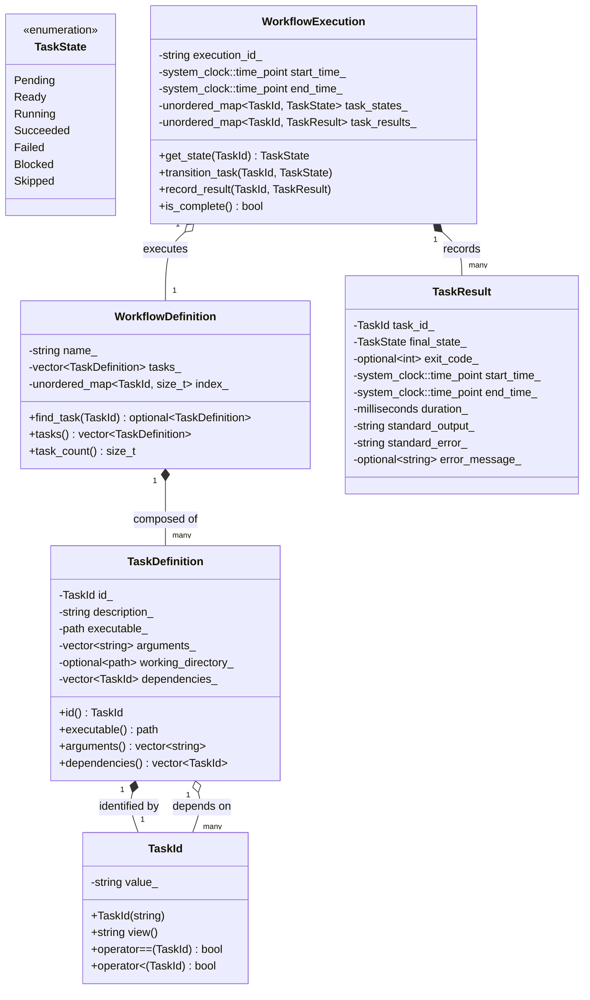

# TaskForge: Domain Model & Invariants

## 1. Domain Overview

The TaskForge domain encompasses the concepts required to represent, validate, and execute directed acyclic graph (DAG) workflows. The design adheres strictly to **object-oriented encapsulation**, **strong typing**, **value semantics**, and **explicit lifecycle state modeling**.

---

## 2. Core Concepts & Taxonomy

---

## 3. Detailed Entity & Value Object Specifications

### 3.1 `TaskId` (Strong Value Type)
- **Role**: Distinct, strongly-typed identifier representing a unique task within a workflow.
- **Why a dedicated type?** 
  - Prevents accidental string mix-ups (e.g., passing a description or executable path where a task ID was expected).
  - Enforces identifier invariants upon construction (e.g., non-empty, valid characters `[a-zA-Z0-9_\-\.]+`).
- **Semantics**: Copyable, movable, comparable (`operator==`, `operator<=>` or `operator<`), hashable (supports `std::unordered_map` and `std::unordered_set`).
- **Ownership**: Passed by value or `const&`. Zero dynamic allocation overhead beyond internal string storage.

### 3.2 `TaskDefinition` (Immutable Value Object)
- **Role**: Complete immutable description of a single unit of execution.
- **Attributes**:
  - `id`: `TaskId` (Unique identifier).
  - `description`: `std::string` (Human-readable description).
  - `executable`: `std::filesystem::path` (Executable file to run).
  - `arguments`: `std::vector<std::string>` (Command-line arguments).
  - `working_directory`: `std::optional<std::filesystem::path>` (Working directory; inherits working dir if `std::nullopt`).
  - `dependencies`: `std::vector<TaskId>` (Prerequisite task IDs).
- **Why NOT a Class Hierarchy?**
  - *Trade-off analysis*: A common beginner OOP trap is creating subclasses for every command type (`BuildTask`, `TestTask`, `CleanTask`).
  - *Decision*: In a workflow engine, execution details differ in *data* (the binary and arguments), not in *behavior* or *interface*. Every command is an external OS process invocation with inputs, environment, and outputs. Polymorphic inheritance here would add virtual table indirection, heap allocations, and rigid class coupling without any behavioral benefit. Value types provide superior cache locality, zero-cost copying/moving, and simplified serialization.
- **Invariants**:
  - `id` must be valid.
  - `executable` must not be empty.
  - A task cannot list itself as a dependency (`dependency != id`).

### 3.3 `WorkflowDefinition` (Aggregate Root)
- **Role**: Represents a validated, immutable task graph configuration.
- **Attributes**:
  - `name`: `std::string` (Name of the workflow).
  - `tasks`: `std::vector<TaskDefinition>` (Collection of tasks).
  - `lookup_index`: Internal map `std::unordered_map<TaskId, size_t>` for $O(1)$ task lookups.
- **Invariants**:
  1. **Uniqueness**: All `TaskDefinition::id` values in the workflow must be distinct.
  2. **Referential Integrity**: Every `TaskId` in every `dependencies` list must match an existing `TaskDefinition::id` within the same workflow.
  3. **Acyclicity**: The dependency relationships must form a Directed Acyclic Graph (DAG). There must be no cycles ($A \rightarrow B \rightarrow A$).
  4. **Non-Empty**: The workflow must contain at least one task.

### 3.4 `TaskState` (Explicit Lifecycle State)
- **Role**: Finite State Machine enumeration representing the lifecycle of each task during execution.
- **States**:
  - `Pending`: Initial state. The task is waiting for prerequisites to evaluate.
  - `Ready`: All prerequisites have transitioned to `Succeeded`. The task is eligible to run.
  - `Running`: The task's process has been launched and is actively executing.
  - `Succeeded`: The task process exited cleanly (exit code 0).
  - `Failed`: The task process exited with non-zero exit code or failed to launch.
  - `Blocked`: The task was never launched because at least one prerequisite was `Failed` or `Blocked`.
  - `Skipped`: The task was explicitly skipped (future extension).

---

## 4. State Transitions and Lifecycle Rules

### Transition Invariants
1. **Monotonic Progression**: Tasks only move forward through the lifecycle; they never regress to an earlier state (e.g., `Running` cannot transition back to `Pending` without an explicit re-run/retry policy).
2. **Terminal State Immutability**: `Succeeded`, `Failed`, and `Blocked` are terminal states. Once entered, no further state transitions are permitted for that task within that execution run.
3. **Execution Precondition**: A task can transition to `Running` **if and only if** its current state is `Ready`.
4. **Block Propagation**: If a task transitions to `Failed` or `Blocked`, every downstream task that directly or transitively depends on it must transition from `Pending` directly to `Blocked`. Independent branches must remain untouched.

---

## 5. `TaskResult` and `WorkflowExecution`

### 5.1 `TaskResult` (Value Object)
Records the complete outcome of a task execution:
- `task_id`: `TaskId`
- `final_state`: `TaskState` (`Succeeded`, `Failed`, or `Blocked`)
- `exit_code`: `std::optional<int>` (`nullopt` if blocked or failed before launch)
- `start_time`: `std::chrono::system_clock::time_point`
- `end_time`: `std::chrono::system_clock::time_point`
- `duration`: `std::chrono::milliseconds`
- `stdout_content`: `std::string`
- `stderr_content`: `std::string`
- `error_message`: `std::optional<std::string>` (Diagnostic message if process failed to spawn or OS call failed)

### 5.2 `WorkflowExecution` (Runtime Aggregate)
- **Role**: Tracks dynamic execution state during a run session.
- **Separation of Concerns**:
  - `WorkflowDefinition` is **immutable design-time data** (thread-safe, reusable across multiple runs).
  - `WorkflowExecution` is **mutable runtime state** (tracks current states, collected results, and execution timestamps for a specific run).
- **Ownership**: Owns the state map `std::unordered_map<TaskId, TaskState>` and results map `std::unordered_map<TaskId, TaskResult>`. Holds a `const&` or `std::shared_ptr<const WorkflowDefinition>` to the definition being executed.
