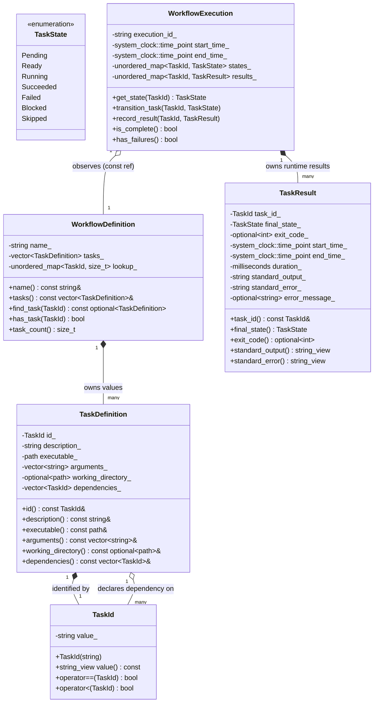
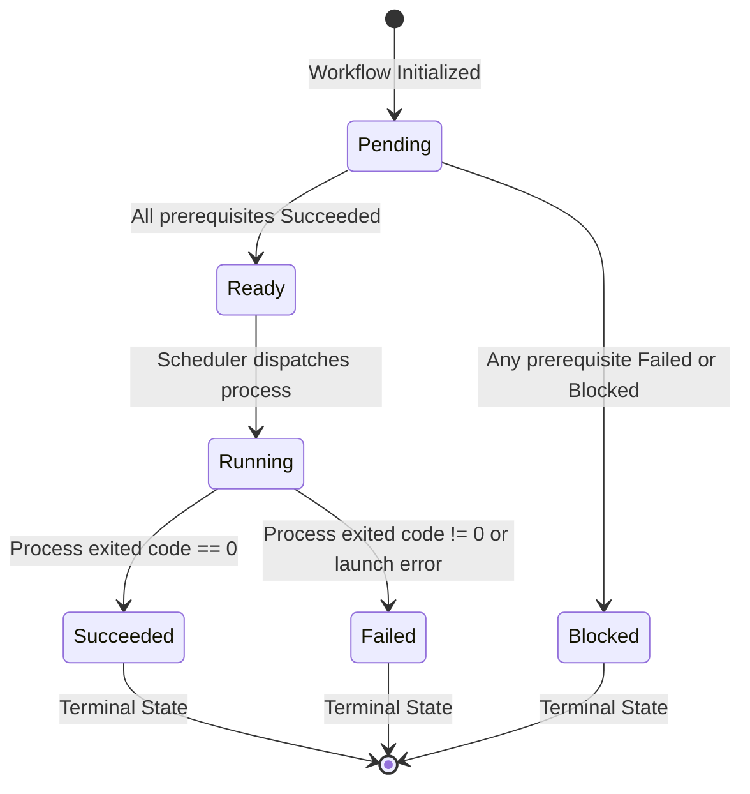

# TaskForge: Domain Model & Invariants

## 1. Domain Overview & Fundamental Architectural Distinctions

The TaskForge domain adheres strictly to **object-oriented encapsulation**, **strong typing**, **value semantics**, and **explicit lifecycle state modeling**.

To ensure high architectural integrity, the domain strictly enforces the following core distinctions:

### A. Workflow Definitions vs. Execution Instances
- **`WorkflowDefinition` (Design-Time Blueprint)**: Immutable, stateless, and thread-safe. Represents the *specification* of tasks, executables, arguments, working directories, and dependencies. It contains no concept of time, process IDs, exit codes, or completion status.
- **`WorkflowExecution` (Runtime State)**: Ephemeral, mutable state tracking a single execution session. Captures wall-clock timestamps, current task states (`TaskState`), process exit codes, captured stdout/stderr, and terminal diagnostics. It references the definition but never modifies it.

### B. Task Identity vs. Task Ownership
- **`TaskId` (Identity)**: A lightweight, copyable value type wrapping a validated identifier string (e.g. `"compile_engine"`). Used for referencing, querying, logging, and dependency declarations.
- **`TaskDefinition` (Data Container)**: Owned exclusively by `WorkflowDefinition` via direct value containment (`std::vector<TaskDefinition>`). No external entity owns a `TaskDefinition`.

### C. Dependency Relationships vs. Ownership Relationships
- In naive OOP, tasks might hold raw pointers or `shared_ptr` to their prerequisites. This couples graph relationships with memory allocation lifetimes.
- In TaskForge, **ownership is a strict hierarchy** (`WorkflowDefinition` owns all tasks), while **dependencies are relational** (`TaskId` edges in a directed adjacency graph). Tasks have zero pointer awareness of each other, completely eliminating cyclic references and dangling pointers.

### D. Failed Tasks vs. Tasks Blocked by Failed Prerequisites
- **`Failed`**: The task was actually scheduled and executed, but exited with non-zero exit code or encountered an OS launch error.
- **`Blocked`**: The task was **never executed** because at least one prerequisite failed or was blocked. Distinguishing `Blocked` from `Failed` is critical for accurate developer diagnostics and preventing hazardous downstream side effects.

### E. Transient Task State vs. Persisted Execution History
- **Transient Task State**: In-memory, mutable state maintained inside `WorkflowExecution` while tasks are evaluating and running.
- **Persisted Execution History**: An immutable, durable snapshot serialized to disk (`.taskforge/history/<run_id>.json`) after execution completes, used exclusively for querying and audit inspections.

### F. Resuming Saved Records vs. Safely Repeating External Commands
- External OS commands (`cmake`, `git`, `ninja`) perform arbitrary side effects on disk and environment.
- A saved history record answers *"What happened in run X?"* (read-only audit).
- Resuming or re-executing a workflow cannot assume that past tasks left the environment in a clean state. External commands are not assumed to be idempotent.

---

## 2. Core Domain Taxonomy & Class Diagram

---

## 3. Detailed Entity & Value Object Specifications

### 3.1 `TaskId` (Strong Value Type)
- **Role**: Distinct, strongly-typed identifier representing a unique task within a workflow.
- **Why a dedicated type?** 
  - Prevents string mix-ups (e.g. passing a path where a task ID was expected).
  - Enforces identifier invariants upon construction (non-empty, characters in `[a-zA-Z0-9_\-\.]+`).
- **Semantics**: Copyable, movable, comparable (`operator==`, `operator<=>` or `operator<`), hashable (`std::hash<TaskId>`).
- **Ownership**: Passed by value or `const&`. Zero dynamic heap allocation beyond internal small-string storage.

### 3.2 `TaskDefinition` (Immutable Value Object)
- **Role**: Complete immutable description of a single unit of execution.
- **Attributes**:
  - `id`: `TaskId` (Unique identifier).
  - `description`: `std::string` (Human-readable description).
  - `executable`: `std::filesystem::path` (Executable file or system tool).
  - `arguments`: `std::vector<std::string>` (Command-line arguments).
  - `working_directory`: `std::optional<std::filesystem::path>` (Working directory; inherits if `std::nullopt`).
  - `dependencies`: `std::vector<TaskId>` (Prerequisite task IDs).
- **Why NOT a Class Hierarchy?**
  - Command tasks in an orchestrator differ only in *data* (executable, arguments, environment), not in *runtime polymorphic behavior*. Every command is an external OS process invocation with inputs, environment, and outputs.
  - Modeling `TaskDefinition` as an immutable value object eliminates virtual table overhead, enables simple deep copying/moving, provides contiguous memory layout in `std::vector`, and simplifies JSON serialization.
- **Invariants**:
  - `id` must be valid and non-empty.
  - `executable` must not be empty.
  - A task cannot depend on itself (`dependency != id`).

### 3.3 `WorkflowDefinition` (Aggregate Root)
- **Role**: Represents a validated, immutable task graph configuration.
- **Attributes**:
  - `name`: `std::string` (Name of the workflow).
  - `tasks`: `std::vector<TaskDefinition>` (Collection of tasks).
  - `lookup_index`: Internal map `std::unordered_map<TaskId, size_t>` for $O(1)$ task lookups.
- **Invariants**:
  1. **Uniqueness**: All `TaskDefinition::id` values in the workflow must be distinct.
  2. **Referential Integrity**: Every `TaskId` in every `dependencies` list must match an existing `TaskDefinition::id` within the same workflow.
  3. **Acyclicity**: The dependency relationships must form a Directed Acyclic Graph (DAG). There must be no direct or indirect cycles ($A \rightarrow B \rightarrow A$).
  4. **Non-Empty**: The workflow must contain at least one task.

### 3.4 `TaskState` (Explicit Lifecycle State)
- **Role**: Explicit Finite State Machine enumeration representing the lifecycle of each task during execution.
- **States**:
  - `Pending`: Initial state. The task is waiting for prerequisites to evaluate.
  - `Ready`: All prerequisites have transitioned to `Succeeded`. The task is eligible to run.
  - `Running`: The task's process has been launched and is actively executing.
  - `Succeeded`: The task process exited cleanly (exit code 0).
  - `Failed`: The task process exited with non-zero exit code or failed to launch.
  - `Blocked`: The task was never launched because at least one prerequisite was `Failed` or `Blocked`.
  - `Skipped`: The task was explicitly skipped (future extension).

---

## 4. State Transitions and Lifecycle Rules

### Transition Invariants
1. **Monotonic Progression**: Tasks only move forward through the lifecycle; they never regress to an earlier state without an explicit re-run policy.
2. **Terminal State Immutability**: `Succeeded`, `Failed`, and `Blocked` are terminal states. Once entered, no further state transitions are permitted for that task within that run.
3. **Execution Precondition**: A task can transition to `Running` **if and only if** its current state is `Ready`.
4. **Block Propagation**: If a task transitions to `Failed` or `Blocked`, every downstream task that directly or transitively depends on it must transition from `Pending` directly to `Blocked`. Independent branches must remain untouched.

---

## 5. `TaskResult` and `WorkflowExecution`

### 5.1 `TaskResult` (Value Object)
Records the complete outcome of a task execution:
- `task_id`: `TaskId`
- `final_state`: `TaskState` (`Succeeded`, `Failed`, or `Blocked`)
- `exit_code`: `std::optional<int>` (`nullopt` if blocked or failed before launch)
- `start_time`: `std::chrono::system_clock::time_point`
- `end_time`: `std::chrono::system_clock::time_point`
- `duration`: `std::chrono::milliseconds`
- `stdout_content`: `std::string`
- `stderr_content`: `std::string`
- `error_message`: `std::optional<std::string>` (Diagnostic message if process failed to spawn or OS call failed)

### 5.2 `WorkflowExecution` (Runtime Aggregate)
- **Role**: Tracks dynamic execution state during a run session.
- **Separation of Concerns**:
  - `WorkflowDefinition` is **immutable design-time data** (thread-safe, reusable across multiple runs).
  - `WorkflowExecution` is **mutable runtime state** (tracks current states, collected results, and execution timestamps for a specific run).
- **Ownership**: Owns the state map `std::unordered_map<TaskId, TaskState>` and results map `std::unordered_map<TaskId, TaskResult>`. Holds a `WorkflowDefinition const&` reference to the definition being executed.
