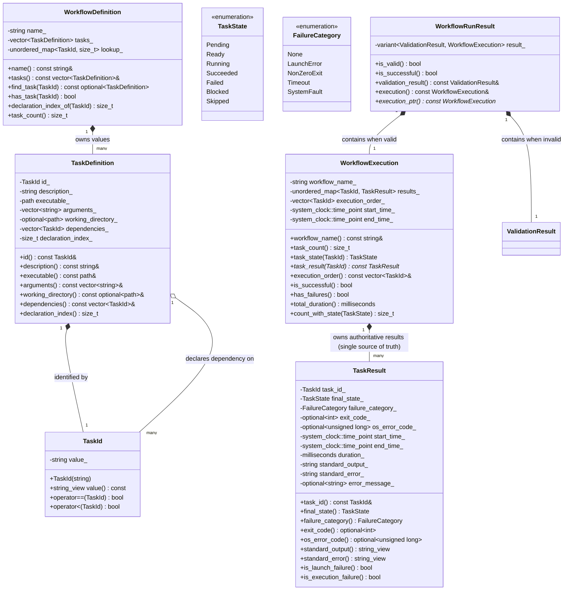

# TaskForge: Domain Model & Invariants

## 1. Domain Overview & Fundamental Architectural Distinctions

The TaskForge domain adheres strictly to **object-oriented encapsulation**, **strong typing**, **value semantics**, and **explicit lifecycle state modeling**.

To ensure high architectural integrity, the domain strictly enforces seven core distinctions:

### A. Workflow Definitions vs. Execution Instances
- **`WorkflowDefinition` (Design-Time Blueprint)**: Immutable, stateless, and thread-safe. Represents the *specification* of tasks, executables, arguments, working directories, and dependencies. It contains no concept of time, process IDs, exit codes, or completion status.
- **`WorkflowExecution` (Runtime State)**: Ephemeral, mutable state tracking a single execution session. Captures wall-clock timestamps, current task states (`TaskState`), failure categories (`FailureCategory`), process exit codes, captured stdout/stderr, and terminal diagnostics. It references the definition but never modifies it.

### B. Task Identity vs. Task Ownership
- **`TaskId` (Identity)**: A lightweight, copyable value type wrapping a validated identifier string (e.g. `"compile_engine"`). Used for referencing, querying, logging, and dependency declarations.
- **`TaskDefinition` (Data Container)**: Owned exclusively by `WorkflowDefinition` via direct value containment (`std::vector<TaskDefinition>`). No external entity owns a `TaskDefinition`.

### C. Dependency Relationships vs. Ownership Relationships
- In naive OOP, tasks might hold raw pointers or `shared_ptr` to their prerequisites. This couples graph relationships with memory allocation lifetimes.
- In TaskForge, **ownership is a strict hierarchy** (`WorkflowDefinition` owns all tasks), while **dependencies are relational** (`TaskId` edges in a directed adjacency graph). Tasks have zero pointer awareness of each other, completely eliminating cyclic references and dangling pointers.

### D. Active Failure vs. Dependency Block
- **`Failed`**: The task was actually scheduled and attempted. It either failed to launch at the OS level (e.g., executable not found) or launched and terminated with a non-zero exit code.
- **`Blocked`**: The task was **never executed** because at least one prerequisite failed or was blocked. Distinguishing `Blocked` from `Failed` is critical for accurate developer diagnostics and preventing hazardous downstream side effects.

### E. Transient Task State vs. Persisted Execution History
- **Transient Task State**: In-memory, mutable state maintained inside `WorkflowExecution` while tasks are evaluating and running.
- **Persisted Execution History**: An immutable, durable snapshot serialized to disk (`.taskforge/history/<run_id>.json`) after execution completes, used exclusively for querying and audit inspections.

### F. Resuming Saved Records vs. Safely Repeating External Commands
- External OS commands (`cmake`, `git`, `ninja`) perform arbitrary side effects on disk and environment.
- A saved history record answers *"What happened in run X?"* (read-only audit).
- Resuming or re-executing a workflow cannot assume that past tasks left the environment in a clean state. External commands are not assumed to be idempotent.

### G. Encapsulated Value Types with Const Query APIs vs. The `const` Member Anti-Pattern
- To guarantee domain integrity without sacrificing performance, classes expose **read-only const accessors** and private non-const member variables.
- Making member variables `const` inside a class deletes default move-assignment operators, prevents `std::swap`, and breaks vector reallocation.
- True value semantics are preserved by keeping members non-const, validating invariants during construction, and omitting public mutator methods. Reassignment and destruction of moved-from objects remain safe.

### H. Division of Invariant Responsibilities & Untrusted Input Handling
To prevent duplicate responsibilities and unreachable dead validation code, invariants are partitioned strictly by architectural layer:
1. **Local Task Invariants (`TaskDefinition`)**: Validates non-empty executable, no duplicate dependencies, and no self-dependencies.
2. **Aggregate Consistency (`WorkflowDefinition`)**: Validates distinct task IDs and establishes deterministic declaration ordering.
3. **Semantic Workflow Invariants (`WorkflowValidator`)**: Validates non-empty workflows, referential integrity (all prerequisites exist), and absence of dependency cycles.
4. **Untrusted Manifest Input (Future Milestone 3 `WorkflowParser`)**: When reading external JSON manifests, the parser parses raw manifest structures, accumulates all syntax and field errors into a `ValidationResult`, and constructs valid `TaskDefinition` / `WorkflowDefinition` domain objects only after raw validation succeeds. This ensures users receive comprehensive error summaries rather than premature exceptions.

---

## 2. Core Domain Taxonomy & Class Diagram



---

## 3. Failure Semantics & Categorization

A task in `TaskState::Failed` must unambiguously preserve *why* it failed.

### 3.1 `FailureCategory`
```cpp
enum class FailureCategory {
    None,         // Succeeded, Blocked, or Skipped
    LaunchError,  // OS failed to spawn process (binary not found, access denied, bad path)
    NonZeroExit,  // Process spawned and ran, but terminated with non-zero exit code
    Timeout,      // Process ran but exceeded maximum configured wall-clock time
    SystemFault   // Win32 pipe broken, IO error, handle exhaustion
};
```

### 3.2 Distinguishing Failure Modes in `TaskResult`

| Failure Mode | `final_state` | `failure_category` | `exit_code` | `os_error_code` | `error_message` |
| :--- | :--- | :--- | :--- | :--- | :--- |
| **Clean Success** | `Succeeded` | `None` | `0` | `nullopt` | `nullopt` |
| **Launch Error** (e.g. missing binary) | `Failed` | `LaunchError` | `nullopt` (no process ran) | Win32 `GetLastError()` (e.g. `2`) | `"CreateProcessW failed: The system cannot find the file specified."` |
| **Execution Error** (e.g. compiler failed) | `Failed` | `NonZeroExit` | Process return code (e.g. `1`) | `nullopt` | `"Process exited with code 1"` |
| **Prerequisite Failed** | `Blocked` | `None` | `nullopt` | `nullopt` | `"Blocked: Prerequisite 'compile' failed."` |

This guarantees that:
1. `TaskResult::is_launch_failure()` returns `true` if and only if `failure_category == FailureCategory::LaunchError`.
2. `exit_code` is never fabricated for commands that never launched.
3. Downstream tasks are marked `Blocked` identically regardless of whether the prerequisite failed due to a launch error or a non-zero exit code.

---

## 4. Deterministic Scheduling & Tie-Breaking Order

When multiple tasks become `Ready` simultaneously (e.g. at the start of a workflow or when a shared bottleneck task completes), the scheduler must dispatch them in a **100% deterministic order**.

### Ordering Invariants:
1. **Primary Tie-Breaker — Declaration Order**:
   - Tasks are evaluated in the order they were defined in the workflow manifest (`declaration_index`).
   - If Task $A$ (index 0) and Task $B$ (index 1) are both ready, Task $A$ is guaranteed to execute before Task $B$.
2. **Secondary Tie-Breaker — Lexicographical `TaskId`**:
   - If declaration index is identical or unavailable, tasks are ordered alphabetically by `id.value()`.
3. **No `std::unordered_map` Order Dependence**:
   - The scheduler ready queue is an ordered data structure (`std::vector<TaskId>` sorted via comparator, or `std::set<TaskId, DeterministicOrder>`).
   - Iteration order is independent of memory address layout, hash seeds, standard library implementations, or compiler versions.

---

## 5. Value Semantics & Invariant Protection

To balance strict invariant protection with idiomatic Modern C++ performance:

1. **Non-Const Private Member Variables**:
   - Member variables are non-const, allowing `TaskDefinition` and `WorkflowDefinition` to be moved efficiently (`std::move`), swapped (`std::swap`), and reallocated within `std::vector` without deep copies.
2. **Encapsulated Construction**:
   - Objects are constructed through validated factory functions (e.g., `TaskDefinition::create(...)` and `WorkflowDefinition::create(...)`).
   - Validation ensures non-empty IDs, non-empty executables, self-dependency prevention, and DAG acyclicity before the object is instantiated.
3. **Immutability through Const-Only Interfaces**:
   - No setters or mutators are provided.
   - All accessors return `const&` or value copies.
   - The aggregate is completely immutable to external consumers after construction.
